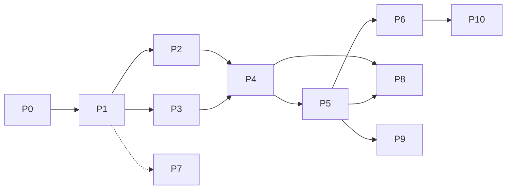

# PLAN.md — 阶段进度与验收基线 (For AI Agents)

本文件面向 **AI Agent**，记录项目的阶段依赖、**当前待办事项**以及各阶段已落地的产出与验收断言基线。
架构不变量与既定技术事实见 [`AGENTS.md`](AGENTS.md)；具体服务器实例的部署与真机联调进展见 `private/host-facts.md`（若存在则必读）。

> [!IMPORTANT]
> - 本文件为公开文件，**严禁写入任何实例专属信息**（真实 IP、域名、UUID、密钥、Token）或 `file:///` 本地绝对路径链接。
> - 完成任务后勾选对应复选框；若改动影响用户可见行为，须同步更新 [`README.md`](README.md)。

---

## 1. 当前待办事项 (Pending Tasks)

目前 P0–P10 全部代码、配置模板、6 项开源前安全加固、Git 提交脱敏与本地自动化测试均已落地通过。仅剩以下两项外部环境联调工作：

- [ ] **P5 桌面三端客户端真机联调（iOS 已完成）**
  - **iOS（Shadowrocket，已完成主体联调，更新订阅后复核）**：① 主/备/双失败态无明文 UDP 53 回退；② 海外冷启动访问 `browserleaks.com/dns` 零国内 DNS 暴露；③ iOS 天气与微信小程序分流正常。
  - **macOS**：导入 `[2] sing-box.json`（SFM）或 `[3] mihomo.yaml`（Clash Verge Rev），验证 TUN 接管、国内外分流、IPv6 阻断及 `browserleaks.com/dns` 零国内 DNS 暴露。
  - **Windows**：导入 `[3] mihomo.yaml`（Clash Verge Rev 服务模式 + TUN）或 `[2] sing-box.json`（v2rayN 自定义配置模式），验证分流、QUIC (`UDP 443`) 降级与防泄漏。
  - **Linux**：使用原生 `sing-box` CLI 或 `mihomo` CLI 启动 `tun0`，执行 `curl` 国内外分流与 DNS 防泄漏验证。
- [ ] **P7 远端 GitHub Actions CI 首次触发**
  - 绑定远端 GitHub 仓库后执行 `git push`，确认 `.github/workflows/ci.yml` 在云端 Runner 全绿通过。

---

## 2. 阶段状态总览

| 阶段 | 主题 | 依赖 | 状态 |
| :--- | :--- | :--- | :--- |
| **P0** | 架构设计与私有配置隔离 | — | ✅ 完成 |
| **P1** | 公共库与预检 (`common.sh` / `00-preflight.sh`) | P0 | ✅ 完成 |
| **P2** | 系统加固与内核优化 (`10-harden.sh` / `20-optimize.sh`) | P1 | ✅ 完成 |
| **P3** | 证书签发与按需重载 (`30-cert.sh`) | P1 | ✅ 完成 |
| **P4** | 服务端部署 (`40-deploy-server.sh`) | P2、P3 | ✅ 完成 |
| **P5** | 客户端生成与高熵订阅发布 (`50-gen-clients.sh`) | P4 | 🟡 代码与 iOS 真机已完成；待桌面三端真机联调 |
| **P6** | `ssctl` 统一 CLI 与事务快照管理 | P1–P5 | ✅ 完成 |
| **P7** | 开源工程化（文档 / 防泄漏钩子 / CI 矩阵） | P1 起并行 | ✅ 本地全套测试通过（待 `git push` 触发远端 CI） |
| **P8** | 可选 Hysteria2 备用协议与端口跳跃 | P4、P5 | ✅ 完成 |
| **P9** | `mihomo.yaml` 生成与官方内核 `-t` 校验 | P5 | ✅ 完成 |
| **P10** | 运维闭环 (`reset` / `upgrade` / `uninstall`) | P6 | ✅ 完成 |

---

## 3. 已完成阶段基线与验收断言 (P0–P10)

### P0 架构设计与私有配置隔离 ✅
- **产出**：[`AGENTS.md`](AGENTS.md)、[`PLAN.md`](PLAN.md)、[`README.md`](README.md)、`.gitignore`、[`examples/env.example`](examples/env.example)、[`examples/host-facts.example.md`](examples/host-facts.example.md)。
- **事实基线**：全仓文档收敛为三份；`private/` 整体 Git 忽略，所有公开模板仅含 RFC 保留值（`example.com` / `203.0.113.10`）。

### P1 公共库与预检 ✅
- **产出**：`scripts/lib/common.sh`、`scripts/00-preflight.sh`。
- **事实基线**：
  - [x] `common.sh`：`EXIT` 级临时目录与隔离 `GNUPGHOME` 自动清理（兼容断链符号链接）；`load_env`、`env_file_has_key`、`env_file_apply_batch` 与 `list_env_file_keys` 统一采用纯数据键值语法与键名白名单（禁止 `source` 执行，校验失败时原文件与 `.env.bak` 零改动），强制收敛 `private/` (`0700`) 与 `.env` (`0600`) 权限及属主；`acquire_ssctl_lock` (`private/.ssctl.lock`) 互斥锁；订阅变量映射、活跃 SSH 端口探测、实例密钥化 `derive_hy2_password` (`v2`) 与 `derive_hy2_obfs_password` 派生函数。
  - [x] `00-preflight.sh`：校验 `debian12|ubuntu2204|ubuntu2404` 与 `amd64|arm64`（支持 `SKIP_OS_CHECK=true`）；校验必填项、语义版本、邮箱、`ACME_NOTIFY_HOOK` 防路径穿越、`private/www/` 禁止符号链接穿越、REALITY 密钥与 uTLS 指纹、`RULESET_*` HTTPS URL 白名单（默认固定 40 位 Commit SHA，可变分支 URL 输出非阻塞告警）、订阅名正则/保留字/后缀唯一性/孤立变量冲突、加密 IP-DoH 白名单（`DNS_DIRECT`: `223.5.5.5|223.6.6.6`；`DNS_REMOTE`: `1.1.1.1|1.0.0.1|8.8.8.8|8.8.4.4|9.9.9.9`）；联网校验 `SERVER_DOMAIN` A 记录匹配 `SERVER_IP` 及真实 RFC 8484 DoH 查询（`HTTP 200` + `RCODE=NOERROR`）；校验代理端口与活跃 SSH 端口冲突、本地端口及 `HY2_HOP_PORTS` UDP 区间监听冲突、Docker 绕过 UFW 警告、Swap 与 NTP 状态。
- **验收断言**：缺失/非法配置精准报错退出；`shellcheck -x` 零警告。

### P2 系统加固与内核优化 ✅
- **产出**：`scripts/10-harden.sh`、`scripts/20-optimize.sh`。
- **事实基线**：
  - [x] `10-harden.sh`：UFW 默认拒绝入站，自动检测并保留宿主当前 SSH 端口（`# ssctl-preserve-ssh`），按 `# ssctl-*` 注释精准维护 `VLESS_PORT/tcp` 与 Hysteria2 UDP 端口及 `nftables` 端口跳跃；通过独立 `table inet ssctl_guard`（`ssctl-vless-guard.service`）对 `VLESS_PORT/tcp` 实施源 IP 并发连接与 SYN 速率抗耗尽防护；启用 `chrony` 或 `systemd-timesyncd`。
  - [x] `20-optimize.sh`：自动加载 `tcp_bbr`，逐项探测并持久化生效的 BBR + `fq`、文件句柄与低配机器 TCP/UDP 缓冲区参数至 `/etc/sysctl.d/99-ssctl.conf`（兼容容器）；配置 `/etc/systemd/journald.conf.d/99-ssctl.conf` 限制日志上限为 `64M` 且保留期不超过 `7day`。
- **验收断言**：重复执行幂等；SSH 不中断；非预期端口全部收敛。

### P3 证书签发与按需重载 ✅
- **产出**：`scripts/30-cert.sh`、`/usr/local/libexec/ssctl-cert-reload`。
- **事实基线**：
  - [x] 固定下载官方 `acme.sh v3.1.0` 并强校验归档 SHA256；以 `CF_API_TOKEN` (`dns_cf`) 签发 `SERVER_DOMAIN` ECC 证书（有效期内精确边界校验 SAN 幂等跳过重签，并同步 Token 与通知钩子）。
  - [x] 安装至 `/etc/ssctl/cert/`（`fullchain.pem` / `key.pem`，`root:sing-box 0750/0640`）；续期钩子在 Nginx 已启用时重载 Nginx，仅当存在 `hysteria2` 入站配置时重启 `sing-box`，失败时记录 `daemon.err` 日志并返回非零退出码（`acme.sh 3.1.0` `_installcert` 与 `renewAll` 随之返回 `1`）。
- **验收断言**：`ssctl status` 准确读取到期天数；续期不中断纯 REALITY 连接。

### P4 服务端部署（REALITY + Vision + Nginx） ✅
- **产出**：`templates/server/*`、`scripts/40-deploy-server.sh`、`scripts/lib/singbox.sha256`。
- **事实基线**：
  - [x] 供应链：SagerNet APT GPG 公钥拒绝含多主钥输入，经隔离 `GNUPGHOME` 指纹（`2C317FBD5D886B4E89BAE8DA6D9152172A2B2F0C`）校验与最小化重导出后二次核验单公钥块单主钥；候选包下载采用 `_apt:root 0700` 隔离目录防 `/tmp` 竞态，离线 `.deb` 回退强校验 `singbox.sha256`；`apt-mark hold` 锁定版本。
  - [x] 模板：`00-log.json`（默认 `warn`）、`05-dns.json`、`10-inbound-vless.json`（`max_time_difference: "2m"`；未认证 TLS 透明回落 Nginx，错误 VLESS UUID 直接关闭连接）、`90-route.json`（依次拦截 `localhost`/`ip6-localhost`/`.local`、`TCP 25`、独立拆分的 SMB/NetBIOS 与 BT 高危端口规则 `135/445/6969` 及 `137:139/6881:6889`、`bittorrent`，再执行 `resolve` + `ip_is_private` 与项目安全策略网段/本机 `SERVER_IP/32`/`::ffff:0:0/96` 拒绝防 DNS Rebinding / SSRF；私钥与用户凭据经环境变量注入 `jq` 避免命令行泄露）。
  - [x] Nginx 与伪装站：仅监听 `127.0.0.1:${REALITY_HANDSHAKE_PORT}`，`access_log off`，收敛连接超时（`10s–15s` + `reset_timedout_connection on`）并提升文件句柄与默认 `worker_connections`（`768 -> 4096`），全站启用 `disable_symlinks on from=$document_root;`，按已安装 Nginx 版本（`>= 1.19.4`）自动启用 `ssl_reject_handshake on;` 拒绝未知/空 SNI（低版本保持真实证书单站点）；高熵订阅隐藏 `Last-Modified` 头并通过 `try_files $uri =404;` 返回与根站一致的 `404`；回落站优先用 `private/www/`（拒绝符号链接，自动忽略 `.gitkeep`），否则混入实例密钥生成无特征多态静态页。
  - [x] 原子部署与沙箱：临时目录渲染通过 `sing-box check`（零弃用警告）与 `nginx -t` 后原子替换，同时通过 `systemctl show` 与 `/proc/<MainPID>/status` 实测校验 `sing-box` 进程 `CapEff` 精确为 `0x400`（`CAP_NET_BIND_SERVICE`），失败自动回滚。
- **验收断言**：GPG 多钥/篡改包被拒绝；动态回环测试下 `rebind.example.com -> 127.0.0.1` 被服务端路由精准拦截。

### P5 客户端生成与高熵订阅发布 🟡
- **产出**：`templates/client/*`、`scripts/50-gen-clients.sh`。
- **事实基线**：
  - [x] 每订阅先在隔离临时目录完成渲染与 `sing-box check` / `mihomo -t` 校验后再原子替换 `private/out/<name>/` 下的 `v2ray`（含 `links.txt`）、`sing-box.json`（`stack: mixed`、`clash_mode`、国内加密 DoH `https://${DNS_DIRECT}/dns-query`、私网与 `100.64.0.0/10` 直连、本地 BT 直连、海外 `UDP 443` 拦截、`http_clients` 代理下载 `.srs`、兼容 `1.14|1.12`）、`mihomo.yaml`（`find-process-mode: off` + 全量加密 IP-DoH）、`shadowrocket.conf`（`[General]` 与 `[Host]` 均采用加密 IP-DoH + 动态海外备用 DoH + `hijack-dns = *:53` + `*.lan` 局域网跳过 + `ENABLE_SUBSCRIPTION=true` 按订阅注入 `update-url` + 90+ 条国内高频主域名/泛子域名及最小 Apple 定位/天气例外直连兜底）及 `urls.txt`。
  - [x] 三端均将出站 `server` 设为 `SERVER_IP`，并将 `SERVER_DOMAIN` 与 `SERVER_IP/32` 在 DNS 与路由中显式设为 `DIRECT` 防回环。
  - [x] 公网订阅通过 `/var/lib/ssctl/releases/sub-web.<ts>.<pid>` + `mv -Tf /var/lib/ssctl/sub-web` 软链原子发布，提交后保留最近 2 个成功版本目录；`ENABLE_SUBSCRIPTION=false` 提交后移除软链并清空 `releases/`。
- **验收断言**：`sing-box check` 与 `mihomo -t` 零报错零警告；iOS 真机已验，待桌面端真机联调（见第 1 节）。

### P6 `ssctl` 统一入口与按需订阅管理 ✅
- **产出**：`ssctl`。
- **事实基线**：
  - [x] 实现 `init`、`deploy`、`add`、`list`、`show`、`reset`、`del`、`flush`、`check`、`status`、`logs`、`restart`、`renew`、`upgrade`、`uninstall`、`help [command]` 一级子命令。
  - [x] `add` / `reset` / `del` 具备目录级物理快照与原 `sub-web` 软链直恢复能力（事务期内含关闭订阅分支均延迟删除旧版本目录），无论在渲染校验阶段或软链切换后发生故障，`.env`、`.env.bak`、`private/out/` 与 `sub-web` 均零差异自动恢复；支持 `--qr <type>` 按需渲染单个终端二维码。
- **验收断言**：渲染失败与软链切换后故障注入下快照与原软链恢复零差异、不断链。

### P7 开源工程化 ✅
- **产出**：[`README.md`](README.md)、[`LICENSE`](LICENSE)、`scripts/hooks/{install-hooks,check-private-leak}.sh`、`.github/workflows/ci.yml`。
- **事实基线**：
  - [x] `check-private-leak.sh`：通过 `0600` 临时特征文件单次 `grep -Fqf` 扫描 Git 暂存区、提交信息与工作区（零外部依赖且避免进程命令行泄露），拦截 `private/` 文件、`.env` 与 `host-facts.md` 敏感值（含多级上级域名、全局 IPv6、Hysteria2 `v2`/`v1` 派生密码与 `obfs` 密码、Base64 节点密文与 `sub://` 深链密文）及 `file:///` 本地链接。
  - [x] `ci.yml`：覆盖 ShellCheck、`.env` 纯数据解析器正负向校验、GPG 多钥/错纹测试、安装包篡改测试、订阅全生命周期与软链切换后故障回滚、候选二进制暂存升级预检（`SSCTL_STAGE_DEB_PATH_OVERRIDE` 断言坏候选版本拦截并回滚）、`SERVER_IPV6=false|true`、`SINGBOX_CLIENT_COMPAT=1.14|1.12`、Hysteria2 端口跳跃与 `HY2_OBFS` 混淆、跨三端策略语义与顺序断言、密钥化多态伪装站与软链穿越拦截、REALITY + Nginx 六类连接测试及四类分层 SSRF / DNS Rebinding 运行时测试。
- **验收断言**：本地防泄漏钩子与 CI 全流程脚本验证通过。

### P8 可选 Hysteria2 备用协议 ✅
- **产出**：`templates/server/singbox/20-inbound-hy2.json`、`10-harden.sh` / `40-deploy-server.sh` / `50-gen-clients.sh` Hysteria2 分支。
- **事实基线**：
  - [x] 服务端复用同一证书，`masquerade` 采用 `file` 模式直接复用 `/var/www/ssctl-site`；密码由实例 `REALITY_PRIVATE_KEY` 与订阅 UUID 混入派生（`v2`），支持可选 `HY2_OBFS=true` 注入同源派生的 `salamander` 混淆；`HY2_HOP_PORTS` 通过独立 `table inet ssctl_hy2` 与 `ssctl-hy2-hop.service` 在服务端监听就绪后实现本地 UDP 端口跳跃重定向。
  - [x] 客户端 `sing-box.json`、`mihomo.yaml`、`v2ray` 自动注入 Hysteria2 节点与自动测速策略组（默认主节点仍为 VLESS），支持 `--qr hy2`。
- **验收断言**：开启/关闭幂等清理防火墙与 `nftables` 表；`reset` 时 Hysteria2 密码同步轮换。

### P9 `mihomo.yaml` 生成与内核校验 ✅
- **产出**：`templates/client/mihomo.yaml`、`scripts/lib/mihomo.sha256`。
- **事实基线**：
  - [x] 配置含 `find-process-mode: off`、VLESS REALITY Vision (`packet-encoding: xudp`)、`tun` (`stack: mixed`、`strict-route: true`、`inet6-address` 接管双栈 IPv6 后按规则阻断)、`sniffer` (`skip-domain`)、`fake-ip-filter`、私网（含 `100.64.0.0/10` Tailscale）与 `SERVER_DOMAIN` + `SERVER_IP/32` 直连、`.mrs` 规则集与国内外全量加密 IP-DoH。
  - [x] 固定官方 `mihomo v1.19.33` SHA256 执行 `mihomo -t` 实测校验。
- **验收断言**：`mihomo -d <workdir> -t -f mihomo.yaml` 校验通过。

### P10 运维闭环 (`reset` / `upgrade` / `uninstall`) ✅
- **产出**：`ssctl` 对应子命令实现。
- **事实基线**：
  - [x] `reset <name>`：同时更换 UUID、派生 Hysteria2 密码与 256-bit 订阅 Token，原子更新公网订阅软链并清除旧 Token 目录。
  - [x] `upgrade <version>`：先在临时隔离目录解压候选版本二进制并完成服务端/客户端渲染配置 `sing-box check` 预检，通过后抑制包维护脚本自动重启旧配置并安装更新；失败离线无损回滚配置、软链与二进制版本。
  - [x] `uninstall [--purge-cert]`：移除服务、配置、Nginx 站点及容量调优片段、sysctl/journald 调优、UFW 代理规则与 `ssctl_guard` / `ssctl_hy2` 表，保留宿主 SSH 与 `private/`（默认保留证书，`--purge-cert` 一并移除证书）。
- **验收断言**：`reset` 后旧 Token 路径立即返回 `404`；`upgrade` 失败可完整回退；`uninstall` 不影响宿主 SSH。
